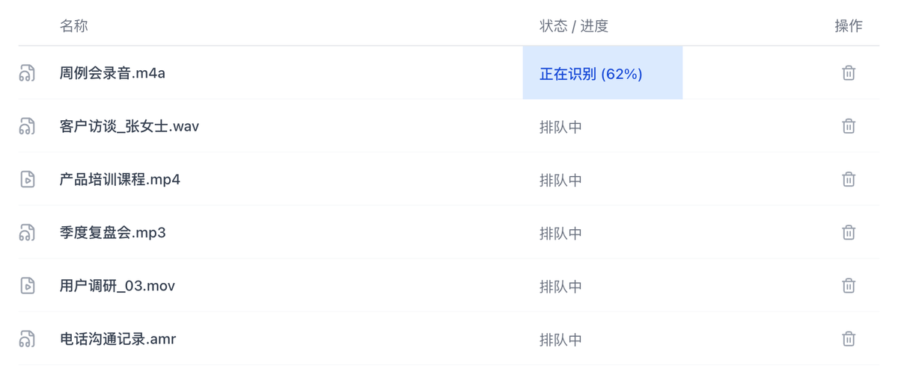
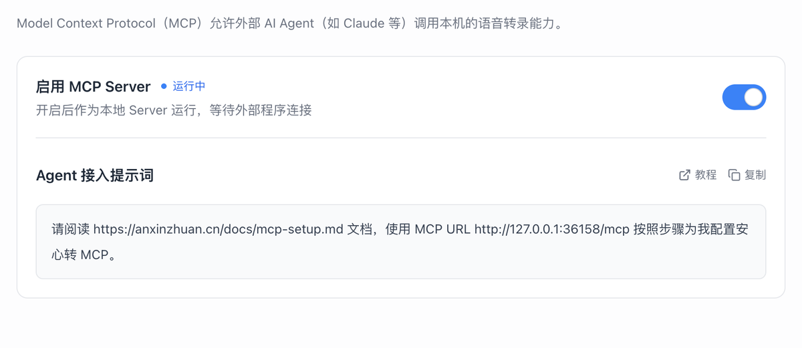

<p align="center">
  <a href="https://anxinzhuan.cn"></a>
</p>

<h1 align="center">安心转 · 离线语音转文字软件</h1>

<p align="center">
  <b>录音、视频批量转文字，全程在本地完成，不上传云端。</b><br>
  会议录音、客户访谈、课程视频、敏感资料，交给自己的电脑处理。
</p>

<p align="center">
  <a href="https://anxinzhuan.cn"><b>🌐 官网</b></a> ·
  <a href="#download"><b>⬇️ 免费下载</b></a> ·
  <a href="https://anxinzhuan.cn/docs"><b>📖 使用文档</b></a> ·
  <a href="https://anxinzhuan.cn/changelog"><b>📝 更新记录</b></a>
</p>

<p align="center">
  
  
  
</p>

> [!TIP]
> **这个仓库有两样东西：**
> 1. **安心转桌面版**：给所有人用的完整软件，图形界面、开箱即用，👉 [直接下载](#download)。
> 2. **anxinzhuan CLI**：开源的极简命令行示例，只面向开发者，见文末 [开发者专区](#cli)。
>
> 不熟悉命令行？直接下载桌面版就好。

<a id="download"></a>

## ⬇️ 下载安心转

<!-- download-table:start -->
| 系统 | 点击下载 | 系统要求 |
| :-- | :-- | :-- |
| **Windows** | <a href="https://github.com/233stone/anxinzhuan/releases/download/v0.5.0/anxinzhuan_0.5.0_x64-setup.exe"></a> | Windows 10 及以上，64 位 |
| **macOS** | <a href="https://github.com/233stone/anxinzhuan/releases/download/v0.5.0/anxinzhuan_0.5.0_AppleSilicon.dmg"></a> <a href="https://github.com/233stone/anxinzhuan/releases/download/v0.5.0/anxinzhuan_0.5.0_Intel.dmg"></a> <a href="https://github.com/233stone/anxinzhuan/releases/download/v0.5.0/anxinzhuan_0.5.0_Universal.dmg"></a> | macOS 12 及以上 |
| **Linux** | <a href="https://github.com/233stone/anxinzhuan/releases/download/v0.5.0/anxinzhuan_0.5.0_amd64.deb"></a> <a href="https://github.com/233stone/anxinzhuan/releases/download/v0.5.0/anxinzhuan_0.5.0_arm64.deb"></a> | Ubuntu 22.04 及以上（.deb） |
| **安卓** | <a href="https://github.com/233stone/anxinzhuan/releases/download/v0.5.0/anxinzhuan_0.5.0_android_arm64.apk"></a> | Android 7.0 及以上 |

**不知道选哪个？**
- **Mac**：点屏幕左上角苹果图标 →「关于本机」，「芯片」写着 Apple M 开头的选 **Apple 芯片**，写着 Intel 的选 **Intel 芯片**；拿不准就选 **通用版**，两种都能装。
- **Linux**：终端运行 `uname -m`，显示 `x86_64` 选 x86_64，显示 `aarch64` 选 ARM64。
- 国内网络下载 GitHub 较慢时，可到官网 [anxinzhuan.cn](https://anxinzhuan.cn) 下载，安装包相同。

<details>
<summary><b>内网版</b>：自带离线模型，适合不能连外网的电脑（点击展开）</summary>

内网版安装后无需联网下载模型，安装包较大（约 300–570 MB），需要[联系我们](https://anxinzhuan.cn)获取授权。

| 系统 | 点击下载 | 系统要求 |
| :-- | :-- | :-- |
| **Windows** | <a href="https://github.com/233stone/anxinzhuan/releases/download/v0.5.0/anxinzhuanoffline_0.5.0_x64-setup.exe"></a> | Windows 10 及以上，64 位 |
| **macOS** | <a href="https://github.com/233stone/anxinzhuan/releases/download/v0.5.0/anxinzhuanoffline_0.5.0_Universal.dmg"></a> | macOS 12 及以上 |
| **Linux** | <a href="https://github.com/233stone/anxinzhuan/releases/download/v0.5.0/anxinzhuanoffline_0.5.0_amd64.deb"></a> <a href="https://github.com/233stone/anxinzhuan/releases/download/v0.5.0/anxinzhuanoffline_0.5.0_arm64.deb"></a> | Ubuntu 22.04 及以上（.deb） |

</details>
<!-- download-table:end -->

## 🤔 为什么选择安心转？

|  | ✅ **安心转** | 在线转写网站 / App |
| :-- | :-: | :-: |
| **文件去哪了** | **留在自己的电脑里** | 上传到对方服务器 |
| **网络要求** | **本地识别，内网也能用** | 必须联网 |
| **批量处理** | **一次导入几十个文件，自动排队** | 多数要逐个上传 |
| **说话人和时间轴** | **自动区分说话人、标注时间点** | 视服务而定 |
| **适合敏感资料** | **适合会议、访谈、内部培训** | 有泄露顾虑 |

## ✨ 核心功能

### 📂 批量语音转文字
一次导入多个音频和视频文件，本地队列自动排队处理。会议录音、课程视频、素材包可以一起整理。



### 🗣️ 说话人和时间轴
文字稿保留说话人和时间点，方便回听校对、整理访谈纪要，也能继续做字幕初稿。


### 🔒 完全本地
音频、视频和生成的文字稿都留在你的设备里，转写过程不需要上传云端。

### 🤖 AI 整理
一键把文字稿整理成会议纪要、面试复盘、课程重点、访谈要点和语音备忘，支持表格、公式和图表。

### 🔌 MCP 调用
通过 MCP 把本地语音转文字接进自己的工作流，让 AI 助手和其他工具直接调用安心转转写录音和视频。



### 🎞️ 格式齐全
- **音频**：mp3、m4a、wav、wma、aac、flac、ogg、opus、amr、aiff、caf、m4b 等
- **视频**：mp4、mov、mkv、avi、flv、webm、m4v、3gp、ts 等

录音和视频可以混在一起导入。

## 🎯 适用场景

| 谁在用 | 用来做什么 |
| :-- | :-- |
| **职场办公** | 周例会、客户沟通、内部复盘的录音转成文字和会议纪要 |
| **记者与研究者** | 人物访谈、用户调研录音批量转写，带说话人方便引用 |
| **老师与学生** | 课程视频、培训录像转文字，整理课程重点 |
| **视频创作者** | 生成带时间点的文字稿，作为字幕初稿继续校对剪辑 |
| **法律、医疗、政企** | 不能外传的录音在本地或内网处理，资料不出设备 |

## ❓ 常见问题

**安心转收费吗？**
可以免费下载使用，部分高级功能需要开通会员。详见[官网](https://anxinzhuan.cn)。

**为什么更适合敏感资料？**
安心转用本地模型完成语音转文字，音频、视频和文字稿不需要上传到公网服务。

**能在内网或断网环境用吗？**
可以。没有外网的电脑请下载上面的**内网版**，自带离线模型。

**支持哪些语言？**
当前重点支持中文和英文。

---

<a id="cli"></a>

## 🛠️ 开发者专区：anxinzhuan CLI（开源）

> [!NOTE]
> 这是一个**极简的命令行示例**，用来演示如何用 [SenseVoice-Small](https://modelscope.cn/models/iic/SenseVoiceSmall-onnx) 在本地把一个音频文件转成文字。它**不是**安心转桌面版的引擎，没有批量、说话人、时间轴等功能。日常使用请下载[桌面版](#download)。

**安装**（需要 [Rust](https://rustup.rs)）：

```bash
cargo install --git https://github.com/233stone/anxinzhuan
```

**使用**：

```bash
anxinzhuan 录音.m4a > 录音.txt
```

- 文字输出到标准输出，进度输出到标准错误。
- 支持 wav、mp3、m4a、aac、flac、ogg、mp4、mkv 等常见格式，取文件的第一条音轨。
- 自动识别中文、英文、粤语、日语、韩语。
- 首次运行从 ModelScope 下载约 240 MB 模型到系统缓存目录（macOS 为 `~/Library/Caches/anxinzhuan`，Linux 为 `~/.cache/anxinzhuan`）。

## 📞 联系我们

- **问题与建议**：欢迎提 [Issues](https://github.com/233stone/anxinzhuan/issues)
- **官网**：[anxinzhuan.cn](https://anxinzhuan.cn)

## 📄 许可证

CLI 代码采用 [MIT](LICENSE) 许可证。安心转桌面版为免费下载的闭源软件，不在此许可范围内。SenseVoice 模型由阿里巴巴通义实验室发布，使用须遵守其[模型许可协议](https://github.com/FunAudioLLM/SenseVoice/blob/main/MODEL_LICENSE)。

## 🙏 致谢

- [SenseVoice](https://github.com/FunAudioLLM/SenseVoice)、[FunASR](https://github.com/modelscope/FunASR)：开源的语音识别模型与框架
- [ONNX Runtime](https://onnxruntime.ai)、[Symphonia](https://github.com/pdeljanov/Symphonia)
